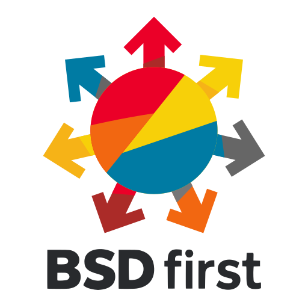

# BSD first



We build on BSD early, while a bad choice of dependency is still an afternoon’s work to undo. Then we make the software run elsewhere, too. That’s the idea behind **BSD first**. Any project that works this way is welcome to wear the badge.

If one port needs a vendor’s SDK, keep that dependency separate. Someone building on BSD should be able to get on with it without opening an account with a company whose operating system they don’t even use. You can boil an egg without registering the saucepan.

A tool can be free and open source and still become a requirement nobody consciously chose. Suppose a Linux distribution uses systemd to start our program at boot. It makes sense to supply a systemd service file for that distribution. But if we build the assumption that systemd is present into the program itself, we’ve made that decision for everyone. Keeping the startup code separate lets people run the same program on BSD, or on Linux with a different init system.

The circle stands for the BSD family. The arrows point toward the other operating systems a project supports. Its own docs will tell you which ones. The gray arrow volunteered to chair a compatibility committee, but all it did at the first meeting was point at the door.

## Get the badge

| Format | When to use it | Download |
| --- | --- | --- |
| **SVG** | The original vector artwork. It stays sharp at any size, from a README badge to a conference banner. | [Open the SVG](https://raw.githubusercontent.com/AlfredoLlaquet/bsd-first/main/bsd-first.svg) |
| **PNG** | A **4096 × 4096** image with a transparent background. Use it in slides, documents, or anywhere that asks for an ordinary image file. Its dark lettering reads best on a light background. | [Open the full-size PNG](https://raw.githubusercontent.com/AlfredoLlaquet/bsd-first/main/bsd-first.png) |

**To save the PNG**, open the full-size link above, right-click the image, and choose **Save Image As…**. On a phone, press and hold the image and choose the save or download option. You can also open either file in this repository and use the download arrow above the preview.

## Put it in your README

Here’s a suggested statement to display with the badge.

<table>
  <tr>
    <td width="128" valign="middle">
      <a href="https://github.com/AlfredoLlaquet/bsd-first">
        
      </a>
    </td>
    <td valign="middle">This application was built and tested on BSD first to make it run well on as many operating systems as possible.</td>
  </tr>
</table>

Save the badge beside your `README.md`, then paste the following where you want it to appear. If you use the PNG, change `./bsd-first.svg` to `./bsd-first.png`. To resize the badge, set both `width` values to the same number of pixels.

```html
<table>
  <tr>
    <td width="128" valign="middle">
      <a href="https://github.com/AlfredoLlaquet/bsd-first">
        
      </a>
    </td>
    <td valign="middle">This application was built and tested on BSD first to make it run well on as many operating systems as possible.</td>
  </tr>
</table>
```

For the badge alone, use this line.

```html

```

## Reuse

The badge artwork is available under **CC0 1.0 Universal**. You can copy it, change it, and redistribute it, including commercially, without asking permission or giving credit. [License text](./LICENSE) · [CC0 summary](https://creativecommons.org/publicdomain/zero/1.0/)

Any saucepan demanding royalties is definitely welcome to plead its case before the High Court of Breakfast. The jury is twelve poached eggs in little wigs.

Created and directed by **Alfredo Llaquet-Alsina**. Implemented by **ChatGPT**.

